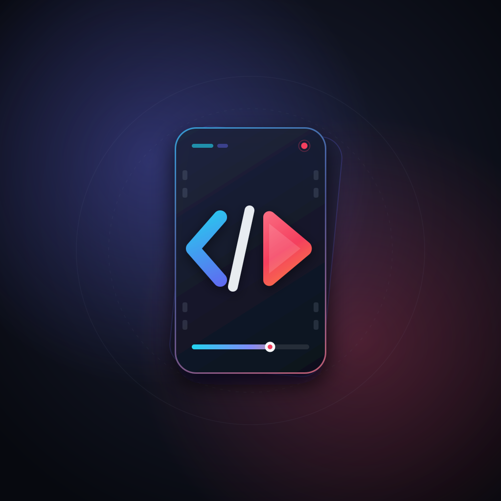

  
  <h1>HTML2Reel Studio</h1>
  
<strong>100% Offline Deterministic HTML5-to-MP4 Video Studio (Android — Kotlin + Rust)</strong>

Converts self-contained HTML5 + CSS + JS / SVG / Canvas storytelling animations (e.g., `1080×1920` 9:16 Reels & Shorts) into frame-accurate **MP4 (H.264 + AAC)** videos without screen recording (`MediaProjection`).

## Architecture

- **Kotlin / Jetpack Compose (`HTML2ReelStudio/app/`):**
  - Material 3 Dark Studio UI (`HomeScreen`, `StudioScreen`, `RenderProgressScreen`, `ExportCompleteScreen`)
  - `VirtualWebViewHost`: Offscreen `VirtualDisplay` + `Presentation` at exact pixel dimensions (`160 dpi`), same-origin `WebViewAssetLoader`, bundled offline `Noto Sans Devanagari` + `Playfair Display` fonts, `2x __nativeRAF` paint barrier, and detached `WebView.draw` fallback
  - `EglSurfaceBlitter` & `VideoEncoder`: Zero-copy `SurfaceTexture` (`GL_TEXTURE_EXTERNAL_OES`) → OpenGL ES 2.0 → `MediaCodec` (`video/avc`, CBR) with `EGLExt.eglPresentationTimeANDROID` nanosecond stamping
  - `RenderForegroundService`: Background-reliable export (`mediaProcessing` on API 35+ with `onTimeout`, `dataSync` fallback on API 34) + partial-output recovery + `MediaStore` (`Movies/HTML2Reel`) export & Share Sheet
- **Rust Native Core (`HTML2ReelStudio/rust_core/`):**
  - `html_shim.rs`: Metadata extraction (`video-duration`, `video-resolution`, `video-fps`), offline `@font-face` + HUD auto-hide injection, Priority-1 `window.seekTo(t)` hook, Priority-2 deterministic virtual clock (`performance.now`, `Date`, `rAF`, timers, `MutationObserver`-cached WAAPI, SVG SMIL)
  - `audio_engine.rs`: Offline decoding (`symphonia`: MP3, WAV, AAC/M4A, OGG, FLAC), `rubato` FFT resampling to 48 kHz stereo, smooth RMS auto-ducking, fade-in/out & soft limiter
  - `muxer.rs`: Pure-Rust Fast-Start ISO-BMFF MP4 muxer (`moov` before `mdat`), Annex-B → AVCC NAL splitting, `esds` AAC packaging, `colr` (`nclx`) + `pasp` atoms
  - Exposed via **Mozilla UniFFI (`0.33`)** & `cargo-ndk` (`arm64-v8a`, `armeabi-v7a`) with 16 KB ELF page alignment

## CI / GitHub Actions Build

Push to `main` or trigger **Actions → Build HTML2Reel Studio (Rust + Android APK)** to run `cargo test`, build Rust `.so` binaries via `cargo-ndk`, generate UniFFI Kotlin bindings, verify 16 KB ELF alignment, run unit tests, and download `app-debug.apk` & `app-release-unsigned.apk` artifacts.
